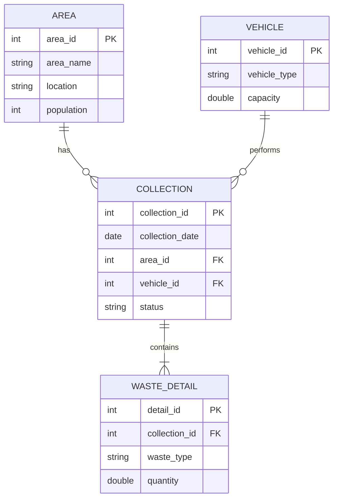

# Database Design

## 1. ER Diagram

## 2. Relationships

| Relationship | Type | Meaning |
|---|---|---|
| Area to Collection | One to Many | One area has many collections |
| Vehicle to Collection | One to Many | One vehicle performs many collections |
| Collection to Waste_Detail | One to Many | One collection has many waste categories |

## 3. Relational Model

| Table | Columns (PK underlined as PK, FK marked) |
|---|---|
| Area | area_id (PK), area_name, location, population |
| Vehicle | vehicle_id (PK), vehicle_type, capacity |
| Collection | collection_id (PK), collection_date, area_id (FK), vehicle_id (FK), status |
| Waste_Detail | detail_id (PK), collection_id (FK), waste_type, quantity |

**Constraints**

| Table | Constraint |
|---|---|
| Collection | status in (Pending, In Progress, Completed) |
| Waste_Detail | waste_type in (Biodegradable, Recyclable, Non-Recyclable) |
| Waste_Detail | quantity > 0 |
| Area | population > 0 |
| Vehicle | capacity > 0 |

## 4. Normalization

### Unnormalized Table (UNF)
Collection_Data(collection_id, collection_date, area_id, area_name, location, population, vehicle_id, vehicle_type, capacity, status, waste_type1, qty1, waste_type2, qty2, waste_type3, qty3)

Problem: repeating groups (waste_type, qty) and repeated area and vehicle data.

### First Normal Form (1NF)
Rule: all values atomic, no repeating groups.

Fix: one row per waste type.

Collection_Data(collection_id, waste_type, quantity, collection_date, area_id, area_name, location, population, vehicle_id, vehicle_type, capacity, status)

Primary key: (collection_id, waste_type)

### Second Normal Form (2NF)
Rule: 1NF and no partial dependency on part of a composite key.

Problem: collection_date, area details, vehicle details, and status depend only on collection_id, not on waste_type.

Fix: split into two tables.
- Collection(collection_id, collection_date, area_id, area_name, location, population, vehicle_id, vehicle_type, capacity, status)
- Waste_Detail(collection_id, waste_type, quantity)

### Third Normal Form (3NF)
Rule: 2NF and no transitive dependency (non-key column depending on another non-key column).

Problem: in Collection, area_name, location, population depend on area_id, and vehicle_type, capacity depend on vehicle_id.

Fix: separate into their own tables.
- Area(area_id, area_name, location, population)
- Vehicle(vehicle_id, vehicle_type, capacity)
- Collection(collection_id, collection_date, area_id, vehicle_id, status)
- Waste_Detail(detail_id, collection_id, waste_type, quantity)

### Result

| Normal Form | Problem removed |
|---|---|
| 1NF | Repeating groups |
| 2NF | Partial dependency |
| 3NF | Transitive dependency |

The final 4 tables are in 3NF.
